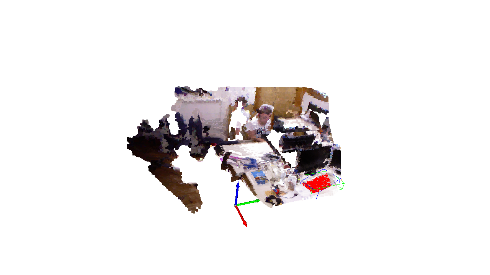
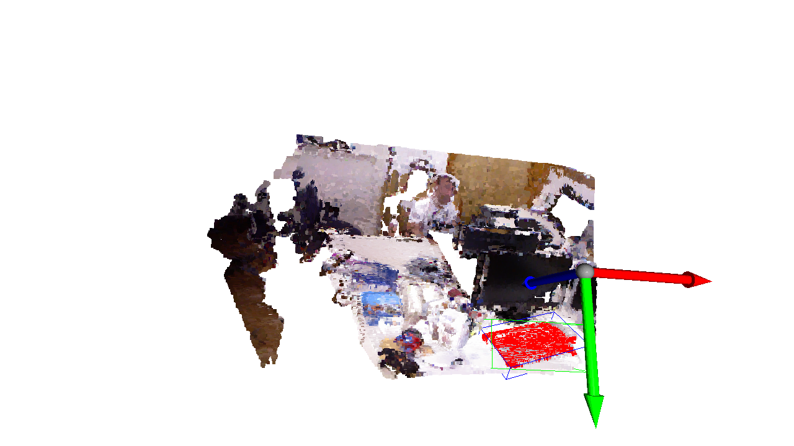

# RGB-D 多帧三维目标感知与点云融合

本项目使用 TUM RGB-D 数据集、YOLO26 实例分割和 Open3D，完成场景与目标点云生成、目标三维定位和多帧融合。项目提供两个独立入口：`main.py` 使用数据集 Groundtruth 位姿融合；`main_icp.py` 使用相邻帧 Point-to-Point ICP 估计位姿并融合，以便学习和比较两种方式。

## 功能

- 根据时间戳匹配 RGB 图像和最近的深度图，并生成彩色场景点云。
- 使用 YOLO26 实例分割提取指定类别，结合深度图获得目标三维点云和中心附近的深度估计。
- 对目标点云进行体素降采样、统计滤波和 DBSCAN 聚类，计算三维中心、AABB 和 OBB。
- 使用 Groundtruth 或相邻帧 ICP 位姿，将多帧场景与目标点云变换到统一坐标系并融合。
- 保存二维分割图、目标点云 PLY 和 Open3D 视图截图。

## 两种融合方式

**Groundtruth 融合（`main.py`）**：为每个 RGB 帧匹配最近的相机位姿，将该帧点云从相机坐标系变换到 Groundtruth 世界坐标系。RGB 与位姿时间差超过 `0.02` 秒时跳过该帧。

**ICP 融合（`main_icp.py`）**：不读取 Groundtruth。先在独立子进程中，用降采样后的场景点云执行相邻帧 Point-to-Point ICP：当前帧为源点云，上一处理帧为目标点云，初始变换为单位矩阵。将每次得到的“当前帧到上一帧”变换依次累乘，得到当前帧到首个处理帧坐标系的变换；随后主进程加载累计位姿，进行 YOLO 分割和场景、目标融合。分进程执行用于隔离 ICP 与 YOLO/PyTorch 的 OpenMP 运行库。

ICP 阶段逐帧输出 Fitness 和对应点 RMSE，Fitness 小于 0.7 时给出警告，但仍继续累计位姿。ICP 对初始位置和场景重叠程度敏感，逐帧误差会累积形成漂移。当前 ICP 入口没有 Groundtruth 误差评估、回环检测或全局优化；两个入口的坐标系不同，不能直接把各自输出的目标坐标当作同一坐标系比较。

```text
RGB + Depth → 时间戳匹配 → 场景点云 ──→ Groundtruth 位姿 / 相邻帧 ICP 累计位姿
       │                                               │
       └→ YOLO 实例分割 → Mask 目标点云 → 滤波、聚类 ──┤
                                                       ↓
                                场景与目标变换、融合 → 中心、包围盒与可视化
```

## 环境与数据

依赖 Python、NumPy、OpenCV、Open3D 和 Ultralytics。在项目根目录安装：

```bash
pip install -r requirements.txt
```

准备以下文件：

- TUM RGB-D Freiburg1 xyz 数据集，放在 `data/rgbd_dataset_freiburg1_xyz/`，包含 `rgb.txt`、`depth.txt`、RGB 与深度图；Groundtruth 入口还需要 `groundtruth.txt`。
- YOLO26 实例分割权重 `yolo26n-seg.pt`，放在项目根目录。

数据集通过 `.gitignore` 排除，不包含在仓库中。相机内参为 `640 × 480`、`fx=517.3`、`fy=516.5`、`cx=318.6`、`cy=255.3`；深度值除以 `5000.0` 转为米，截断距离为 `5.0` 米。

## 运行

在项目根目录执行：

```bash
# 使用 Groundtruth 位姿融合
python main.py

# 使用 ICP 估计位姿并融合
python main_icp.py

# Groundtruth 融合的帧数与体素大小对比实验
python parameter_experiment.py
```

两个融合入口默认从第 0 帧开始，每隔 2 帧处理一帧，共 50 帧（第 0、2、…、98 帧），目标类别为 `keyboard`。需要更改时，请分别修改对应入口文件顶部的参数。`main_icp.py` 的模块开头说明仍写有 20 帧，实际默认值以 `num_frames = 50` 为准。

| 参数 | 默认值 | 作用 |
| --- | ---: | --- |
| `start_frame` / `num_frames` / `frame_step` | `0` / `50` / `2` | 起始帧、处理帧数和采样间隔 |
| `target_class` | `keyboard` | 目标类别 |
| `scene_voxel_size` / `fusion_voxel_size` | `0.01` / `0.01` m | 单帧场景及融合场景体素大小 |
| `object_voxel_size` | `0.005` m | 目标点云体素大小 |
| `outlier_nb_neighbors` / `outlier_std_ratio` | `20` / `2.0` | 统计滤波参数 |
| `dbscan_eps` / `dbscan_min_points` | `0.03` m / `10` | DBSCAN 聚类参数 |
| `icp_voxel_size` | `0.02` m | ICP 所用点云的体素大小 |
| `icp_threshold` | `0.05` m | ICP 对应点最大距离 |
| `icp_max_iteration` | `50` | ICP 最大迭代次数 |

后三项仅用于 `main_icp.py`。ICP 点云使用较粗的体素，融合仍使用场景和目标各自的体素大小。

## 输出与可视化

```text
outputs/
├── 2D/                     # Groundtruth 入口逐帧分割图
├── 3D/                     # Groundtruth 入口三维视图
├── point/                  # Groundtruth 融合目标 PLY
└── icp/
    ├── icp_poses.npz       # 帧索引与 ICP 累计 4×4 位姿
    ├── 2D/                 # ICP 入口逐帧分割图
    ├── 3D/                 # ICP 融合三维视图
    └── point/              # ICP 融合目标 PLY
```

Open3D 显示彩色场景、红色目标点云、绿色 AABB、蓝色 OBB 和坐标轴。窗口创建时保存默认视角；调整视角后按 `S` 可覆盖截图。PLY 文件只保存融合目标点云。再次运行可能覆盖相同名称的输出。

### 示例结果

Groundtruth 融合（50 帧，更新后的三维视图）：



ICP 融合：



仓库中原有的一次 Groundtruth 50 帧实验记录为：融合 50 帧场景，其中 39 帧检测到键盘，最终目标点云包含 34,466 个点。下面为此前 `parameter_experiment.py` 的单次实测记录；时间不包含模型首次加载、结果写入和窗口等待，数值随环境与运行变化：

| 帧数 | Frame Step | Voxel Size (m) | 融合场景点数 | 目标点数 | 运行时间 |
| ---: | ---: | ---: | ---: | ---: | ---: |
| 10 | 2 | 0.010 | 101,580 | 16,229 | 0.85 s |
| 20 | 2 | 0.010 | 114,729 | 18,486 | 1.43 s |
| 50 | 2 | 0.010 | 509,932 | 34,466 | 3.85 s |
| 50 | 2 | 0.005 | 1,946,412 | 188,173 | 8.77 s |
| 50 | 2 | 0.020 | 112,902 | 5,580 | 2.64 s |

表中体素大小用于单帧和融合场景，目标体素大小为其一半。该表仅描述 Groundtruth 流程，不是 ICP 精度评估。

## 项目结构

```text
├── main.py                  # Groundtruth 多帧融合入口
├── main_icp.py              # 相邻帧 ICP 位姿估计与多帧融合入口
├── muti_frame.py            # 多帧融合独立验证脚本
├── parameter_experiment.py  # Groundtruth 融合参数实验
├── utils/
│   ├── dataset.py           # 数据索引和时间戳读取
│   ├── geometry.py          # 深度、反投影与位姿变换
│   ├── pointcloud.py        # 点云生成、滤波和几何计算
│   └── visualization.py     # 结果保存与显示
├── test_camera.py           # 摄像头目标检测学习代码
├── test_RGBD.py             # RGB-D 读取和深度估计学习代码
├── test_pointcloud.py       # 场景点云生成学习代码
├── test_object_pointcloud.py # 目标点云流程学习代码
├── data/                    # 本地 TUM 数据集，不提交
├── outputs/                 # 运行结果
└── requirements.txt
```

后续可继续评估 ICP 与 Groundtruth 的位姿误差、研究漂移控制和目标跨帧关联，并探索接入实时相机和机器人系统。
